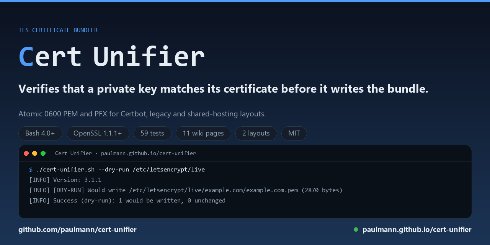

# Cert Unifier

Cert Unifier 3.1.1 ist ein geprüfter PEM- und PFX-Bundler für Betreiber von
Let's-Encrypt-, Certbot- und Legacy-Zertifikatsstrukturen: Er schreibt ein Paket pro
Domain erst, nachdem er nachgewiesen hat, dass der private Schlüssel zum Endzertifikat
gehört, und verweigert Einträge, die er nicht prüfen kann.

[](https://github.com/paulmann/cert-unifier/actions/workflows/ci.yml)
[](https://github.com/paulmann/cert-unifier/releases)
[](LICENSE)
[](https://www.gnu.org/software/bash/)
[](https://www.openssl.org/)

<p align="center"></p>

[English](README.md) · [Deutsch](README.de.md) · [中文](README.zh.md) · [हिन्दी](README.hi.md) · [Español](README.es.md) · [Русский](README.ru.md)

[Wiki](https://github.com/paulmann/cert-unifier/wiki) · [Veröffentlichungen](https://github.com/paulmann/cert-unifier/releases) · [Sicherheit](SECURITY.md) · [Mitwirken](CONTRIBUTING.md) · [Für Agenten](AGENTS.md)

## Inhalt

- [Was es tut](#was-es-tut)
- [Warum ein Unifier prüfen muss](#warum-ein-unifier-prüfen-muss)
- [Anforderungen](#anforderungen)
- [Installation](#installation)
- [Verwendung](#verwendung)
- [Optionen](#optionen)
- [Layouts](#layouts)
- [JSON-Zusammenfassung](#json-zusammenfassung)
- [Exit-Codes](#exit-codes)
- [Sicherheit](#sicherheit)
- [Dokumentation](#dokumentation)
- [Tests](#tests)
- [Mitwirken](#mitwirken)
- [Lizenz](#lizenz)
- [Changelog](#changelog)

## Was es tut

Cert Unifier durchsucht einen Verzeichnisbaum mit Let's-Encrypt-Material, prüft,
ob jeder private Schlüssel wirklich zu seinem Endzertifikat gehört, und schreibt
ein geprüftes Bündel pro Domain: den privaten Schlüssel, gefolgt von der
vollständigen Kette.

- **Abgleich der öffentlichen Schlüssel** für RSA- und EC-Schlüssel (Vergleich
  von `openssl x509 -pubkey` mit `openssl pkey -pubout`), kein Modul-Hash, der
  nur für RSA funktioniert.
- **Verweigert das Schreiben, was nicht geprüft werden kann**: ein nicht
  passender Schlüssel, ein mit Passphrase geschützter Schlüssel, ein unlesbarer
  Schlüssel oder ein fehlender Schlüssel stoppen diesen Eintrag mit einem
  Fehler, statt ein defektes Bündel zu erzeugen.
- **Atomare Schreibvorgänge**: Der Inhalt wird im Zielverzeichnis
  zusammengesetzt, auf Modus 0600 gesetzt und dann über das Ziel umbenannt.
- **Idempotent**: Ein byte-identisches Bündel bleibt unberührt (mtime bleibt
  erhalten), und bei einem bereits vorhandenen Bündel mit Modus 0644 wird der
  Modus korrigiert.
- **Optionaler PKCS#12-Export** für IIS/Windows und optionale Warnungen zum
  Ablaufdatum.
- **Maschinenlesbare** `--json`-Zusammenfassung für die Automatisierung.
- **Kein Netzwerkzugriff**: Das Skript fordert niemals Zertifikate an,
  erneuert, widerruft oder installiert sie und lädt niemals einen Dienst neu.

## Warum ein Unifier prüfen muss

Ein Bündel ist nur nützlich, wenn der darin enthaltene Schlüssel zum Zertifikat
passt. Die üblichen Fehlerfälle verlaufen still: Certbot rotiert den privaten
Schlüssel bei der Erneuerung, Legacy-Layouts halten `_le1`, `_le2`, `_le10`
nebeneinander, und Betreiber kopieren den falschen Schlüssel. Ein Webserver,
der mit einem nicht passenden Schlüssel startet, scheitert später beim
Handshake — zum ungünstigsten Zeitpunkt. Cert Unifier behandelt die
Übereinstimmung von Schlüssel und Zertifikat als Voraussetzung, nicht als
Warnung.

## Anforderungen

| Anforderung | Warum |
|-------------|-----|
| Bash 4.0 oder neuer | Arrays, `shopt`, Prozesssubstitution |
| `openssl` 1.1.1 oder 3.x | Abgleich öffentlicher Schlüssel, PEM-Validierung, PKCS#12-Export |
| `flock` (optional) | verhindert, dass zwei Läufe denselben Baum anfassen |
| Lesezugriff auf Schlüssel und Zertifikate | der private Schlüssel wird ins Bündel gelesen |
| Schreibzugriff auf das Ausgabeverzeichnis | Bündel werden neben den Quellen geschrieben |

Linux, macOS und WSL werden unterstützt. macOS liefert Bash 3.2 mit;
installieren Sie ein neueres Bash (`brew install bash`) oder führen Sie das
Skript mit `bash` aus Homebrew aus.

## Installation

```bash
wget https://raw.githubusercontent.com/paulmann/cert-unifier/main/cert-unifier.sh
chmod +x cert-unifier.sh
./cert-unifier.sh --version
```

Systemweit:

```bash
sudo install -m 755 cert-unifier.sh /usr/local/bin/cert-unifier
```

## Verwendung

```bash
# 1. inspect the tree without writing anything
./cert-unifier.sh --dry-run --verbose /etc/letsencrypt/live

# 2. run it on the tree root, not on a single domain directory: for Certbot
#    the root is the directory that holds the per-domain folders, and a single
#    domain directory matches nothing (exit 2)
./cert-unifier.sh /etc/letsencrypt/live

# 3. PEM plus PKCS#12 (the password is read from the environment)
PFX_PASSWORD='...' ./cert-unifier.sh --pfx /var/www/certs

# 4. legacy tree with more than one generation per domain
./cert-unifier.sh --no-tld-filter --recursive /opt/certs
```

Jeder verarbeitete Eintrag schreibt `<domain>.pem` (privater Schlüssel, dann
Endzertifikat, dann Zwischenzertifikate) neben seine Quelldateien oder, wenn
angegeben, in `--output-dir`.

## Optionen

| Option | Beschreibung | Standard |
|--------|-------------|---------|
| `-h, --help` | Hilfe anzeigen und beenden | |
| `-V, --version` | Version anzeigen und beenden | |
| `-d, --dry-run` | Prüfen und berichten, nichts schreiben | aus |
| `-v, --verbose` | DEBUG-Protokollierung | aus |
| `-t, --tlds LIST` | Zulässige TLDs, durch Komma oder Leerzeichen getrennt | `ru com` |
| `-o, --output-dir PATH` | Bündel hier statt neben den Quellen schreiben | wie Quelle |
| `--no-tld-filter` | Jede Domain verarbeiten | aus |
| `--no-key-validation` | Bündeln, auch wenn der Schlüssel nicht geprüft werden kann | aus |
| `--pfx` | Zusätzlich eine `.pfx` schreiben | aus |
| `--pfx-password PASS` | PFX-Passwort (bevorzugt `PFX_PASSWORD`) | leer |
| `--skip-pfx-on-mismatch` | Nicht passende Einträge überspringen statt zu scheitern | aus |
| `--check-expiry` | Vor Zertifikaten kurz vor dem Ablauf warnen | aus |
| `--expiry-days N` | Schwellwert der Ablaufwarnung in Tagen | `30` |
| `--recursive` | Für das Legacy-Layout in Unterverzeichnisse absteigen | aus |
| `--json` | Maschinenlesbare Zusammenfassung auf stdout ausgeben | aus |

Umgebungsvariablen: `ALLOWED_TLDS`, `LOG_LEVEL` (`DEBUG`, `INFO`, `WARN`,
`ERROR`), `PFX_PASSWORD`, `CERT_UNIFIER_LOCK`, `NO_KEY_VALIDATION`.

## Layouts

**Certbot**

```text
/etc/letsencrypt/live/example.com/fullchain.pem
/etc/letsencrypt/live/example.com/privkey.pem
→ /etc/letsencrypt/live/example.com/example.com.pem
```

**Legacy**

```text
example.com_le10.crt      leaf certificate
example.com_le10.crtca    chain
example.com_le10.key      private key (or example.com.key)
→ example.com.pem
```

`N` kann eine beliebige Zahl sein. Sind mehrere Generationen einer Domain im
selben Verzeichnis vorhanden, gewinnt das höchste `N`, sodass ein altes `_le1`
niemals ein neueres `_le10` überschreibt.

## JSON-Zusammenfassung

```bash
./cert-unifier.sh --json /etc/letsencrypt/live
```

```json
{
  "version": "3.1.1",
  "status": "success",
  "processed": 1,
  "skipped": 0,
  "planned": 0,
  "errors": 0,
  "warnings": 0,
  "results": [
    {"domain": "example.com", "status": "updated", "pem": "/etc/letsencrypt/live/example.com/example.com.pem", "fingerprint": "..."}
  ]
}
```

`status` ist `success`, `none` (nichts passte) oder `error`. Warnungen und
Fehler gehen weiterhin nach stderr, damit stdout parsebar bleibt.

## Exit-Codes

| Code | Bedeutung |
|------|---------|
| 0 | Alles Angeforderte wurde erledigt (in `--dry-run` wurde alles geplant) |
| 1 | Laufzeit- oder Validierungsfehler; mindestens ein Eintrag wurde abgelehnt |
| 2 | Keine passenden Zertifikate gefunden |
| 130 | Durch INT oder TERM unterbrochen |

## Sicherheit

- Der private Schlüssel wird immer mit Modus 0600 und unter `umask 077`
  geschrieben.
- Schreibvorgänge sind im Zielverzeichnis atomar; ein fehlgeschlagener Lauf
  lässt das vorherige Bündel intakt.
- Die einzige Datei, die außerhalb des durchsuchten Baums angelegt wird, ist die
  Sperrdatei (`/var/lock/cert-unifier.lock`, überschreibbar mit
  `CERT_UNIFIER_LOCK`).
- Das PFX-Passwort wird OpenSSL auf der Kommandozeile übergeben und ist damit
  für die Dauer dieses Aufrufs in `ps` sichtbar. Bevorzugen Sie eine kurzlebige
  Umgebungsvariable; ein leeres Passwort erzeugt eine unverschlüsselte
  PFX-Datei.
- Das Skript löscht niemals Quelldateien, greift niemals auf das Netzwerk zu
  und lädt niemals einen Dienst neu.

## Dokumentation

| Dokument | Inhalt |
|----------|--------|
| [README.md](README.md) | Überblick, Verwendung und Optionen dieser Datei |
| [Wiki](https://github.com/paulmann/cert-unifier/wiki) | Ausführliche Anleitungen und Betriebshinweise |
| [AGENTS.md](AGENTS.md) | Nicht-interaktive Anweisungen für KI-Agenten |
| [CHANGELOG.md](CHANGELOG.md) | Versionsverlauf mit semantischen Versionen |
| [SECURITY.md](SECURITY.md) | Wie man eine Sicherheitslücke meldet |
| [CONTRIBUTING.md](CONTRIBUTING.md) | Wie man eine Änderung vorschlägt und testet |
| [Releases](https://github.com/paulmann/cert-unifier/releases) | Veröffentlichte Versionen und ihre Artefakte |

## Tests

```bash
chmod +x tests/run-tests.sh
./tests/run-tests.sh
```

Die Testsuite erzeugt echte RSA- und EC-Fixtures mit OpenSSL und prüft
Exit-Codes, Bündelinhalte, Berechtigungen, Idempotenz, das Verhalten im
Dry-Run, die JSON-Gültigkeit, den PKCS#12-Export, die Verweigerung bei nicht
passenden, fehlenden und mit Passphrase geschützten Schlüsseln sowie die
Aufräumarbeiten. Sie läuft bei jedem Push in GitHub Actions.

## Mitwirken

Siehe [CONTRIBUTING.md](CONTRIBUTING.md) und [SECURITY.md](SECURITY.md).
Änderungen sollen `tests/run-tests.sh` und `shellcheck` sauber halten.

## Lizenz

Veröffentlicht unter der Lizenz [MIT](LICENSE), © 2026 Mikhail Deynekin.

## Changelog

Siehe [CHANGELOG.md](CHANGELOG.md).
