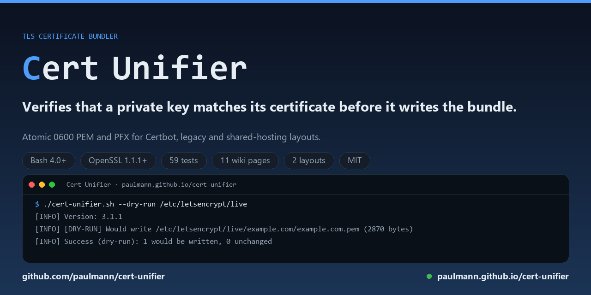

# Cert Unifier wiki



Cert Unifier is a single self-contained Bash script that turns the certificate
material Certbot, Let's Encrypt and legacy `_leN` layouts leave on disk into one
audited `<domain>.pem` bundle — private key followed by the full chain — and
refuses to write a bundle whose private key does not match its certificate.

**Version 3.1.1** (released 2026-11-02, the first published release of the 3.x
line). `./cert-unifier.sh --version` reports the same number, and this wiki
documents that release.

## Quick start

```bash
# 1. fetch the script and check what you downloaded
wget -O cert-unifier.sh https://raw.githubusercontent.com/paulmann/cert-unifier/main/cert-unifier.sh
chmod +x cert-unifier.sh
./cert-unifier.sh --version

# 2. inspect the tree; writes nothing
./cert-unifier.sh --dry-run --verbose /etc/letsencrypt/live

# 3. write the bundles
./cert-unifier.sh /etc/letsencrypt/live
```

Requirements: Bash 4.0 or later and OpenSSL 1.1.1+/3.x; `flock` is optional.
The script never requests, renews or revokes certificates, never reloads a
service and never touches the network.

Installation, upgrade and uninstall are covered in
[Install and upgrade](07-Install-and-Upgrade).

## Pages

| Page | What it covers |
|---|---|
| [Home](Home) | this page: overview and quick start |
| [Why unify certificates](01-Why-Unify) | the failure modes a unifier has to answer |
| [Layouts](02-Layouts) | the two supported input layouts and the newest-wins rule |
| [Security model](03-Security) | what the script protects, and what it does not |
| [Testing](04-Testing) | how to run the suite and what it asserts |
| [Command reference](05-Command-Reference) | every option, environment variable and default |
| [JSON summary and exit codes](06-JSON-and-Exit-Codes) | the `--json` schema, status values and automation |
| [Install and upgrade](07-Install-and-Upgrade) | requirements, installation, upgrade, uninstall |
| [Troubleshooting](08-Troubleshooting) | symptom, cause and fix for common failures |
| [Architecture](09-Architecture) | the run pipeline, components and design decisions |
| [FAQ](10-FAQ) | short answers to recurring questions |

The same tree is in the sidebar on every page.

## Repository documents

| Document | Contents |
|---|---|
| [README](https://github.com/paulmann/cert-unifier/blob/main/README.md) | summary, usage, options, exit codes |
| [AGENTS.md](https://github.com/paulmann/cert-unifier/blob/main/AGENTS.md) | the agent-facing operational contract |
| [CHANGELOG](https://github.com/paulmann/cert-unifier/blob/main/CHANGELOG.md) | version history and fixed defects |
| [SECURITY.md](https://github.com/paulmann/cert-unifier/blob/main/SECURITY.md) | threat model and private reporting |
| [CONTRIBUTING.md](https://github.com/paulmann/cert-unifier/blob/main/CONTRIBUTING.md) | style, tests and review rules |
| [LICENSE](https://github.com/paulmann/cert-unifier/blob/main/LICENSE) | MIT |
| [Releases](https://github.com/paulmann/cert-unifier/releases) | tags and release notes |
| [Issues](https://github.com/paulmann/cert-unifier/issues) | bug reports and questions |

## Where to start

If you operate certificates, read [Why unify certificates](01-Why-Unify), then
[Layouts](02-Layouts) and the [Command reference](05-Command-Reference). If you
are wiring the script into automation, [JSON summary and exit
codes](06-JSON-and-Exit-Codes) is the contract you need; if something already
failed, go straight to [Troubleshooting](08-Troubleshooting).
